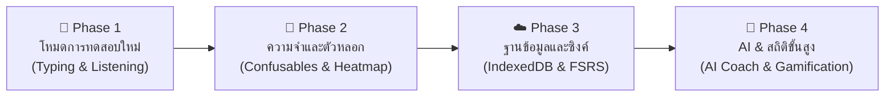

# แผนงานพัฒนาระบบควิซภาษาญี่ปุ่น (JLPT PWA Roadmap)

เอกสารสรุปแผนงานพัฒนา ยกระดับ และขยายขีดความสามารถของระบบเรียนรู้ภาษาญี่ปุ่น **JLPT PWA v5** โดยรวมทั้งระบบหลัก (`index.html`) และระบบควิซวัดความจำด้วยความเร็ว (`quiz.html`)

---

## 1. สถานะระบบปัจจุบัน (Current Status)

ระบบปัจจุบันได้รับการออกแบบให้ทำงานร่วมกันได้อย่างสมบูรณ์ โดยไม่กระทบโครงสร้างเดิม:

| คอมโพเนนต์ | ไฟล์ | บทบาทหลัก | สถานะ |
|---|---|---|:---:|
| **ระบบหลัก (JLPT Core)** | `index.html` | คลังคันจิ N5/N4/N3, ศัพท์ N5, ไวยากรณ์, สถานการณ์จริง, Flashcard, ระบบ SRS SM-2 และ Streak 7 วัน | ✅ **สมบูรณ์** |
| **ระบบควิซใหม่ (Speed & Mastery Quiz)** | `quiz.html` | ควิซจับเวลาความเร็ว 4 วิ, Auto-advance 0.8 วิ, สถานะ 4 ระดับ (แม่น/นิ่ง/ซ่อม/ยังไม่ทดสอบ), Custom Dropdown, จัดการคำศัพท์ส่วนตัว และ Bulk Import | ✅ **สมบูรณ์** |
| **แคชออฟไลน์ (PWA Service Worker)** | `sw.js` | บันทึกไฟล์ทั้งสองระบบและชุดข้อมูลทั้งหมด รองรับการติดตั้งลงหน้าจอหลักและใช้งาน Offline 100% | ✅ **สมบูรณ์** |

---

## 2. ฟังก์ชันที่พัฒนาสำเร็จแล้ว (Completed Milestones)

- [x] **ดีไซน์โมเดิร์น Midnight Navy:** โทนสีกรมท่าเข้ม (`#0c101b`), การ์ดมนขอบนุ่มตา และปุ่มหลักสี Periwinkle/Indigo
- [x] **Custom Dropdown Component:** สลับระดับบทเรียนได้อย่างราบรื่น พร้อมลูกศรหมุนอนิเมชัน และเครื่องหมายถูก (✓)
- [x] **ระบบจับเวลาตอบรายข้อ (Speed Metrics):** กำหนดเกณฑ์ $\le 4$ วินาที พร้อมไฟแสดงสถานะ เขียว/ส้ม
- [x] **Auto-advance เมื่อถูกและเร็ว:** หากตอบถูกภายใน 4 วินาที ระบบจะเลื่อนไปข้อถัดไปอัตโนมัติภายใน 0.8 วินาที
- [x] **ควิซ 4 รูปแบบ (Multi-Directional Quiz):**
  - `คำ → ความหมาย` (ญี่ปุ่น $\rightarrow$ แปลไทย)
  - `ความหมาย → คำ` (ไทย $\rightarrow$ ญี่ปุ่น)
  - `คันจิ → เสียงอ่าน` (คันจิ $\rightarrow$ ฮิรางานะ)
  - `ผสม` (สุ่มทิศทางอัตโนมัติ)
- [x] **การสุ่มแบบถ่วงน้ำหนัก (Priority-based Queueing):** คัดเลือกคำที่มีสถานะ **ซ่อม** และ **ยังไม่เคยทดสอบ** ขึ้นมาก่อนคำที่แม่นแล้ว
- [x] **แถบความคืบหน้า 4 สี (Multi-Segment Progress Bar):**
  - 🟢 **แม่นแล้ว:** ตอบถูกติดต่อกัน 2 ครั้งขึ้นไป
  - 🟡 **กำลังนิ่ง:** ตอบถูกล่าสุด 1 ครั้ง
  - 🔴 **ต้องซ่อม:** ตอบผิดล่าสุด
  - ⚪ **ยังไม่ทดสอบ:** ยังไม่เคยทำแบบทดสอบ
- [x] **ระบบจัดการคำศัพท์ส่วนตัว (Custom Vocab CRUD):** เพิ่มคำเดี่ยว, แก้ไข, ลบคำตัวอย่าง และวางข้อความหลายคำพร้อมกัน (Bulk Import ด้วย `Tab` หรือ `|`)
- [x] **เสียงอ่านออกเสียงภาษาญี่ปุ่น (TTS):** ใช้งาน Web Speech API รองรับการออกเสียงชัดเจน
- [x] **ทางเชื่อมต่อ 2 ระบบ:** ปุ่มสลับระหว่าง `index.html` และ `quiz.html` ได้ตลอดเวลาโดยไม่เสียข้อมูล
- [x] **โหมดพิมพ์ตอบโรมาจิ (Romaji Typing Mode):** พิมพ์เสียงอ่านพร้อมระบบตรวจการสะกดทางเลือกอัตโนมัติ (`tsu/tu`, `shi/si`, `fu/hu`, `wo/o`, `n/nn`) เกณฑ์ความเร็ว $\le 6$ วิ
- [x] **โหมดควิซการฟัง (Listening Quiz Mode):** ซ่อนตัวอักษร ฟังเสียงอ่านภาษาญี่ปุ่นอัตโนมัติ แล้วเลือกความหมายไทย
- [x] **โหมดสปีดรัน 60 วินาที (Time Attack Mode):** แข่งทำโจทย์ต่อเนื่องกับเวลานับถอยหลัง 60 วิ พร้อมระบบสะสม Combo คูณคะแนนและจัดอันดับ Rank S/A/B/C/D

---

## 3. แผนงานการพัฒนาต่อยอด (Development Roadmap)

---

### 📌 Phase 1: ยกระดับรูปแบบการทดสอบ (Quiz Modalities & Interactivity)
> **เป้าหมาย:** เพิ่มมิติการทดสอบนอกเหนือจากการเลือกตอบ 4 ชอยส์ เพื่อฝึกการจำเชิงรุก (Active Recall)

1. **โหมดพิมพ์ตอบโรมาจิ (Romaji Typing Mode):**
   - ให้ผู้ใช้พิมพ์คำอ่านเป็นตัวอักษรภาษาอังกฤษ/โรมาจิ
   - รองรับการสะกดทางเลือกอัตโนมัติ:
     - `tsu` / `tu`
     - `shi` / `si`
     - `chi` / `ti`
     - `fu` / `hu`
     - `wo` / `o`
     - `n` / `nn`
   - ปรับเกณฑ์ความเร็วสำหรับโหมดพิมพ์เป็น $\le 6$ วินาที
2. **โหมดควิซการฟัง (Listening Quiz Mode):**
   - ซ่อนตัวอักษรภาษาญี่ปุ่น แล้วเล่นเสียงอ่านอัตโนมัติ
   - ให้ผู้เรียนฟังเสียงแล้วเลือกความหมายภาษาไทย เพื่อฝึกทักษะการฟังโดยไม่พึ่งสายตา
3. **โหมดแข่งกับเวลา (Speed Run / Time Attack):**
   - กำหนดเวลา เช่น 60 วินาที ตอบให้ได้มากที่สุด
   - มีตัวคูณคะแนน (Combo Multiplier) เมื่อตอบถูกต่อเนื่องรวดเร็ว

---

### 🧠 Phase 2: ตัวเลือกหลอกอัจฉริยะและข้อมูลช่วยจำ (Memory & Mnemonics)
> **เป้าหมาย:** จัดการกับตัวอักษรและคันจิที่สับสนง่าย พร้อมเทคนิคช่วยจำ

1. **ระบบตัวเลือกหลอกหน้าตาคล้ายกัน (Confusable Distractors):**
   - **ฮิรางานะ/คาตาคานะ:** ดึงตัวหลอกจำเพาะ เช่น ぬ หลอกด้วย め/ね/む, れ หลอกด้วย ね/わ/ろ, さ หลอกด้วย き/ち
   - **คันจิ:** สุ่มคำหลอกที่มีส่วนประกอบ (Radicals) หรือความหมายใกล้เคียงกัน
2. **การ์ดช่วยจำและกฎแยกคู่ (Mnemonic & Pairing Rule Overlays):**
   - เมื่อตอบผิด ให้แสดงภาพจำภาษาไทย (เช่น `す` = เส้นนอนมีห่วงเหมือนผมม้วน, `つ` = สึนามิ)
   - กฎแยกคู่ชัดเจน เช่น `る` (มีห่วงที่ปลาย) vs `ろ` (ปลายเปิดไม่มีห่วง)
3. **ตารางแผนที่ความจำ 46 ช่อง (Kana Mastery Heatmap):**
   - หน้าแสดงตารางอักษร 46 ตัวแบ่งตามแถว (a, ka, sa, ta, na, ...)
   - แต้มสีสถานะตามความแม่นยำ (เขียว/ส้ม/แดง/เทา)
   - สามารถแตะที่ตัวอักษรเพื่อฟังเสียง และดูสถิติจำนวนครั้งที่ถูก/ผิดรายตัวได้ทันที

---

### ☁️ Phase 3: ฐานข้อมูลและการซิงค์ข้อมูล (Database & Cloud Sync)
> **เป้าหมาย:** ทลายขีดจำกัดของ LocalStorage และรองรับการเรียนรู้ต่อเนื่องข้ามอุปกรณ์

1. **ยกระดับสู่ IndexedDB & บันทึกประวัติรายครั้ง (Review Event Logging):**
   - เก็บข้อมูลประวัติการกดตอบทุกครั้ง `{ itemId, timestamp, elapsedMs, result }`
   - รองรับข้อมูลศัพท์ได้หลายหมื่นคำโดยไม่ติดขีดจำกัด 5MB
2. **บูรณาการอัลกอริทึม FSRS (Free Spaced Repetition Scheduler):**
   - คำนวณช่วงเวลาทบทวนที่แม่นยำตามหลักวิทยาศาสตร์ความจำ
   - แปลงผลการตอบตามเวลา:
     - ตอบผิด $\rightarrow$ `Again`
     - ถูกแต่ช้า (> 4 วิ) $\rightarrow$ `Hard`
     - ถูกและเร็ว ($\le 4$ วิ) $\rightarrow$ `Good`
     - ถูกเร็วมากเทียบกับค่าเฉลี่ยของตนเอง $\rightarrow$ `Easy`
3. **ระบบ Cloud Sync ข้ามอุปกรณ์:**
   - เชื่อมต่อกับ Google Drive หรือ Supabase (บริการฐานข้อมูลฟรี)
   - ผู้ใช้สามารถเปิดทำแบบฝึกหัดบนมือถือ และกลับมาเปิดคอมพิวเตอร์เพื่อเรียนต่อได้ทันที
4. **นำเข้าและส่งออกไฟล์มาตรฐาน (Import / Export Integration):**
   - รองรับไฟล์ Deck ของ **Anki (.csv / .apkg)**
   - นำเข้าไฟล์ Excel / CSV จากตารางสรุปคำศัพท์ในชั้นเรียน

---

### 🤖 Phase 4: ระบบ AI และเกมมิฟิเคชัน (AI Coach & Gamification)
> **เป้าหมาย:** เสริมความเข้าใจเชิงลึกและสร้างวินัยการเรียนรู้อย่างต่อเนื่อง

1. **AI Contextual Examples & Nuance Explainer:**
   - ให้ AI ช่วยแต่งประโยคตัวอย่างตามระดับ N5-N3 อัตโนมัติสำหรับคำศัพท์ที่ผู้ใช้เพิ่มเอง
   - ปุ่มถาม AI เมื่อต้องการทราบความแตกต่างระหว่างคำศัพท์ใกล้เคียง (เช่น `知る` vs `分かる`, `行く` vs `来る`)
2. **เป้าหมายรายวันและปฏิทินความต่อเนื่อง (Daily Goals & Streaks):**
   - ตั้งเป้าหมาย เช่น "วันละ 20 คำ" หรือ "15 นาทีต่อวัน"
   - ปฏิทินแสดงความสม่ำเสมอแบบ GitHub Heatmap แสดงจำนวนคำที่ทบทวนในแต่ละวัน

---

## 4. ตารางจัดลำดับความสำคัญ (Priority Matrix)

| ลำดับ | ฟังก์ชัน | ผลกระทบต่อการเรียน | ความยากในการพัฒนา | แนะนำสำหรับขั้นถัดไป |
|:---:|---|:---:|:---:|:---:|
| **1** | **โหมดพิมพ์ตอบโรมาจิ (Romaji Typing Mode)** | สูงมาก (ช่วยสะกดคำได้แม่น) | ปานกลาง | 🚀 **แนะนำทำก่อน** |
| **2** | **ตารางแผนที่ความจำ 46 ตัวอักษร (Kana Heatmap Grid)** | สูง (เห็นภาพรวมทันที) | ง่าย-ปานกลาง | 🚀 **แนะนำทำก่อน** |
| **3** | **โหมดควิซการฟัง (Listening Mode)** | สูง (ฝึกทักษะการฟัง) | ง่าย (ใช้ Web Speech API เดิม) | ⭐ ลำดับถัดไป |
| **4** | **ตัวเลือกหลอกจำเพาะ (Confusable Distractors)** | ปานกลาง-สูง | ง่าย (มีตารางข้อมูลแล้ว) | ⭐ ลำดับถัดไป |
| **5** | **Cloud Sync ข้ามอุปกรณ์ (Google Drive / Supabase)** | สูงมาก (ใช้สะดวกทุกที่) | สูง | วางแผนระยะกลาง |
| **6** | **FSRS & IndexedDB** | สูงมาก (ระยะยาว) | สูง | วางแผนระยะยาว |

---

> 📝 **บันทึกการจัดทำ:** เอกสารนี้สร้างขึ้นเมื่อวันที่ 13 พฤศจิกายน 2026 เพื่อใช้เป็นแนวทางมาตรฐานในการพัฒนาฟีเจอร์สำหรับระบบควิซและคลังคำศัพท์ภาษาญี่ปุ่น

